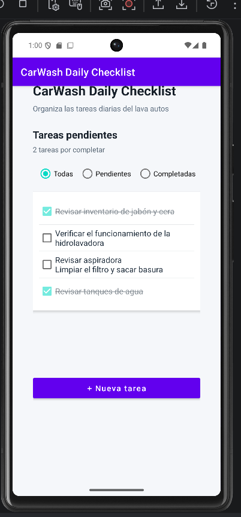
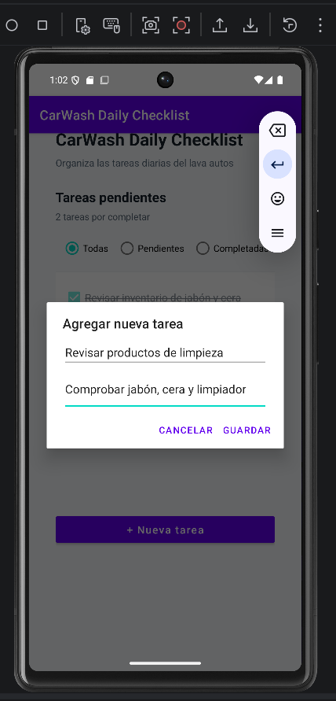
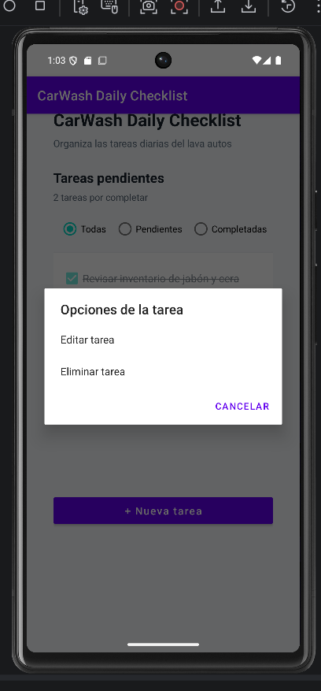
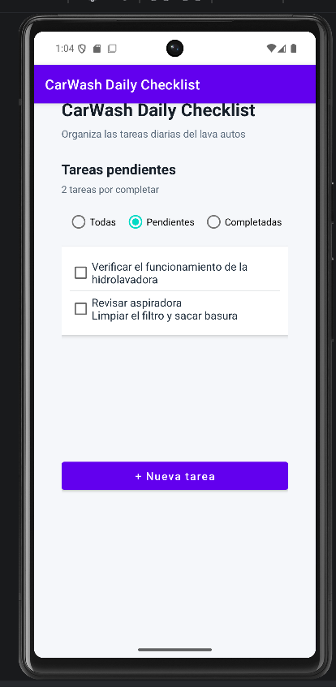
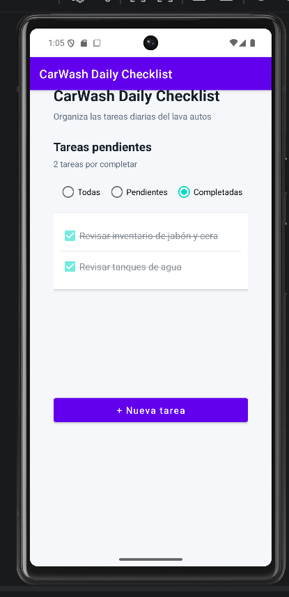

CarWash Daily Checklist

CarWash Daily Checklist es una aplicación móvil para Android que permite organizar y supervisar las tareas diarias de un lava autos. El proyecto surge de una necesidad observada en mi lugar de trabajo, donde actividades como revisar los productos de limpieza, organizar las herramientas y verificar los equipos deben realizarse diariamente.

La aplicación ayuda a reducir olvidos y ofrece una forma sencilla de registrar, completar y consultar las tareas operativas.

1. Problema identificado

    En un lava autos se realizan numerosas actividades de rutina que son necesarias para mantener la calidad del servicio. Muchas de estas actividades se recuerdan de manera informal o se comunican verbalmente, lo que puede ocasionar retrasos, olvidos o inconsistencias.

    CarWash Daily Checklist convierte ese procedimiento informal en una lista digital que permite supervisar las tareas desde un dispositivo Android.

2. Funciones principales
   
La versión actual permite:

    Crear tareas con título y descripción opcional.

    Validar que cada tarea tenga un título.

    Mostrar todas las tareas guardadas.

    Editar el título y la descripción.

    Eliminar tareas mediante una confirmación.

    Marcar tareas como completadas o pendientes.

    Mostrar un contador de tareas pendientes.

    Filtrar las tareas por estado:

    Todas.

    Pendientes.

    Completadas.

    Mostrar mensajes cuando un filtro no tiene resultados.

    Conservar la información después de cerrar la aplicación.

    Desplazar la pantalla cuando existen muchas tareas.

3. Tecnologías utilizadas
   Android Studio.
   Kotlin.
   XML para la interfaz.
   Android SDK.
   Android Jetpack.
   Room.
   SQLite.
   Kotlin Coroutines y Flow.
   Gradle.
   KSP.
   Git.
   GitHub.
   GitHub Desktop.

4. Arquitectura y almacenamiento
   La aplicación separa la representación de las tareas de la gestión de los datos. Room funciona como una capa de abstracción sobre SQLite y permite almacenar la información localmente.

La estructura principal de datos contiene:

Task
├── id
├── title
├── description
├── isCompleted
└── createdAt
Los componentes principales son:

data/
├── Task.kt
├── TaskDao.kt
└── AppDatabase.kt
Task.kt representa cada tarea almacenada.
TaskDao.kt contiene las operaciones para consultar, insertar, actualizar y eliminar tareas.
AppDatabase.kt crea y administra la base de datos local.
MainActivity.kt conecta la interfaz con los datos y controla las acciones del usuario.

5. Funcionamiento
   Al iniciar la aplicación, Room recupera las tareas guardadas y las presenta en la pantalla principal. Si la base de datos está vacía durante la primera ejecución, se agregan algunas tareas iniciales relacionadas con la operación del lava autos.

Cuando se crea, edita, completa o elimina una tarea, Room guarda el cambio automáticamente. La interfaz observa las modificaciones mediante Flow, por lo que la lista y el contador se actualizan sin reiniciar la aplicación.

Para editar o eliminar una tarea, se debe mantener presionado el elemento correspondiente.

6. Capturas de la aplicación
   
Pantalla principal

Formulario de nueva tarea

Opciones de gestión

Tareas pendientes

Tareas completadas

7. Cómo ejecutar el proyecto
  
    Clonar el repositorio: git clone https://github.com/Michael3848/CarWash-Daily-Checklist.git
   
    Abrir Android Studio.

    Seleccionar Open y abrir la carpeta del proyecto.

    Esperar a que termine la sincronización de Gradle.

    Crear o iniciar un dispositivo desde Device Manager.

    Seleccionar la configuración app.

    Pulsar Run.

La aplicación fue probada en un dispositivo virtual Pixel 6 con API 35.

8. Pruebas realizadas
   Se verificaron las siguientes operaciones:

    Inicio sin cierres inesperados.

    Validación del título obligatorio.

    Creación de tareas.

    Edición sin duplicados.

    Cancelación de edición.

    Eliminación con confirmación.

    Cancelación de eliminación.

    Marcado y desmarcado.

    Actualización del contador.

    Filtros de todas, pendientes y completadas.

    Mensajes para filtros sin resultados.

    Desplazamiento con listas largas.

    Conservación de datos después de cerrar y volver a abrir la aplicación.

9. Estado del proyecto

   Idea y problema empresarial definidos.

   Wireframes preliminares elaborados.

   Proyecto Android creado con Kotlin.

   Actividad principal configurada.

   Interfaz XML implementada.

   Creación de tareas implementada.

   Edición de tareas implementada.

   Eliminación de tareas implementada.

   Marcado de tareas como completadas.

   Persistencia local con Room y SQLite.

   Filtros de tareas implementados.

   Desplazamiento vertical implementado.

   Pruebas funcionales completadas.

   Código publicado mediante commits y push.

   Capturas de evidencia agregadas.

   Versión funcional preparada.

10. Posibles mejoras futuras

    Incorporar prioridades y categorías.

    Agregar fechas límite.

    Generar recordatorios mediante WorkManager.

    Añadir búsqueda de tareas.

    Implementar un historial por fecha.

    Permitir exportar un reporte de tareas.

    Incorporar sincronización opcional en la nube.

    Agregar diferentes cuentas o roles.

    Implementar pruebas automatizadas adicionales.

11. Repositorio y documentación

    Repositorio: https://github.com/Michael3848/CarWash-Daily-Checklist
    
    README: https://github.com/Michael3848/CarWash-Daily-Checklist/blob/main/README.md

    Changelog: https://github.com/Michael3848/CarWash-Daily-Checklist/blob/main/CHANGELOG.md

    Autor
    Michael Ramirez